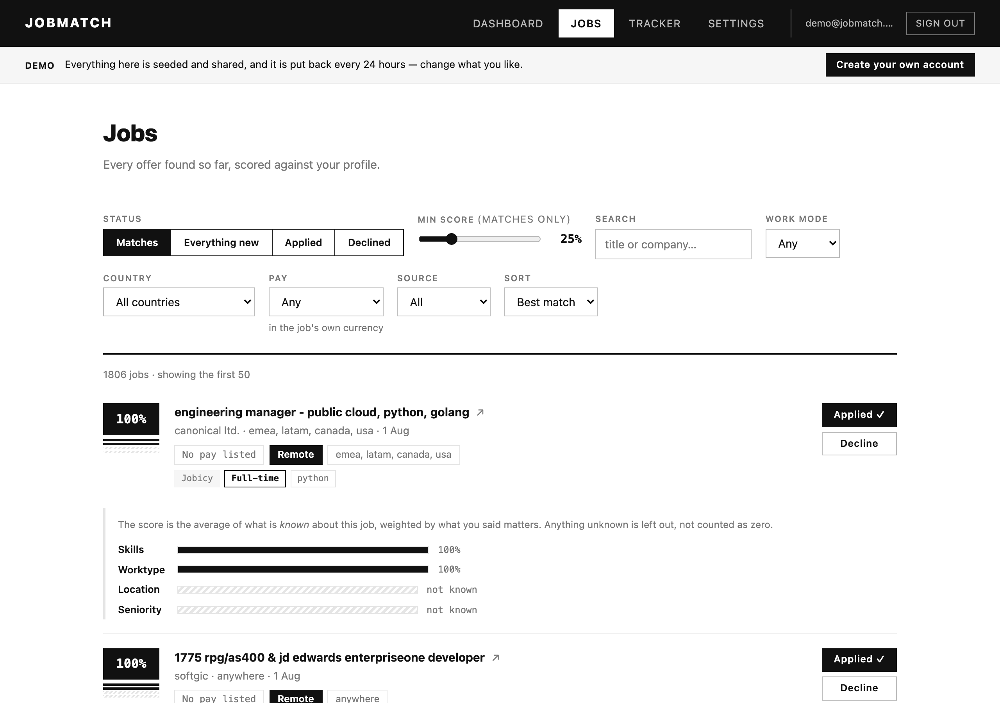
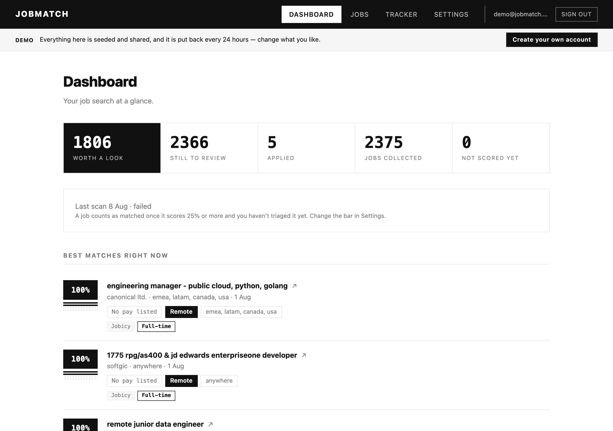
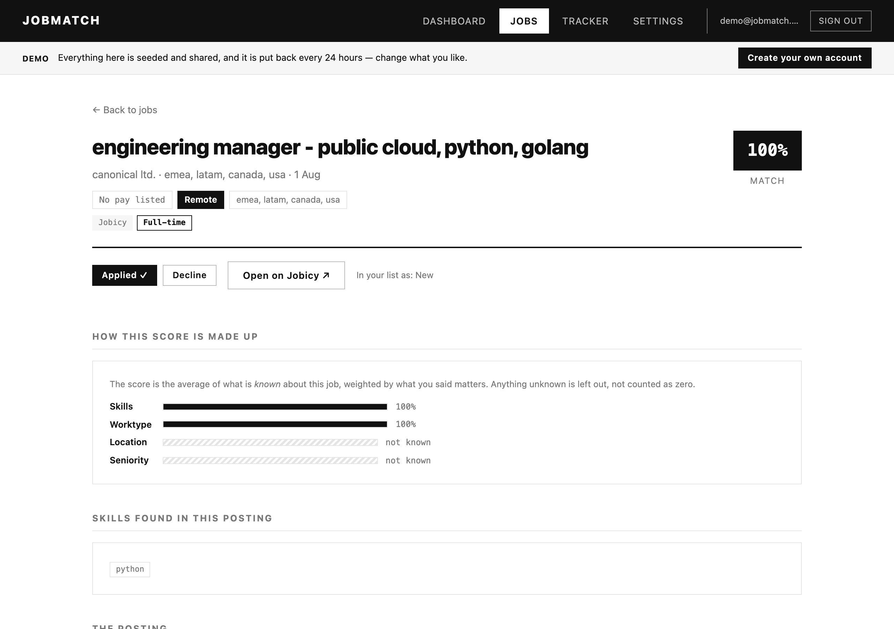
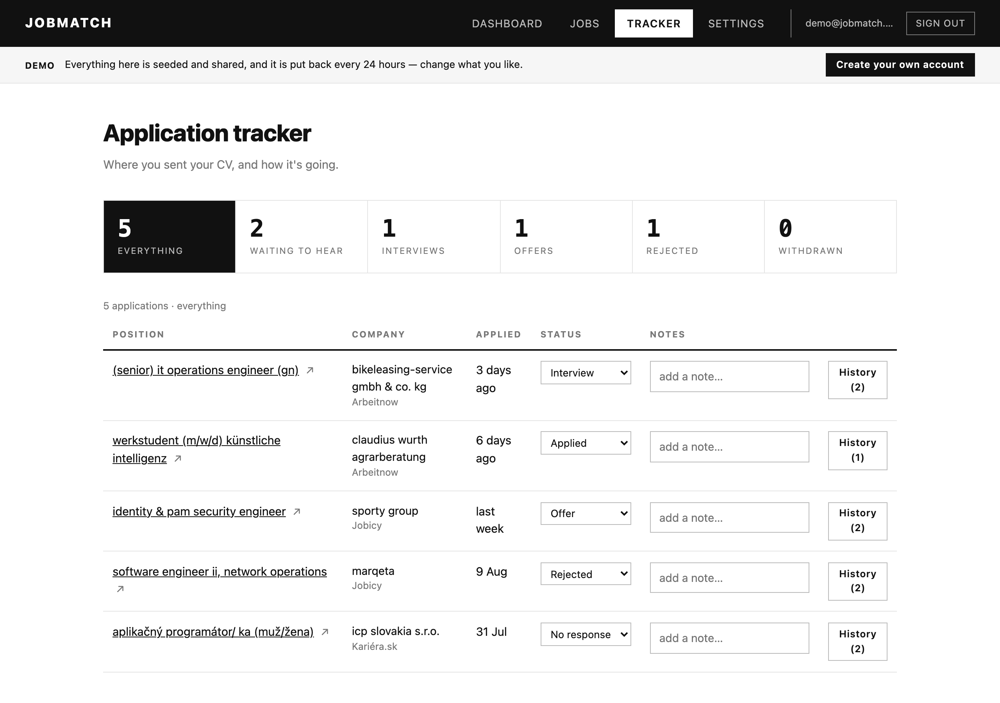
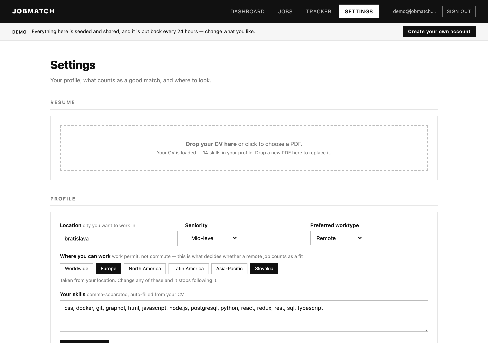
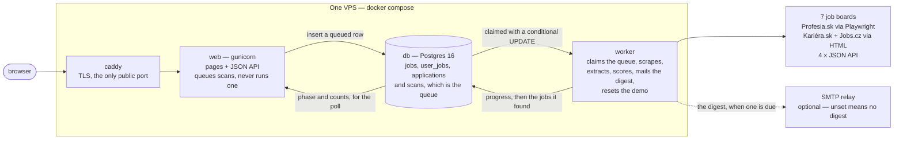

# JobMatch

Scans Slovak and international job boards on a schedule, scores every posting
0–100 against your CV and preferences, and tracks where you applied.


<picture>
  <source srcset="static/screens/jobs-dark.png" media="(prefers-color-scheme: dark)">
  
</picture>

> **Live demo** — not yet. The box is the one thing left in
> [Phase 5 of the roadmap](ROADMAP.md): everything it needs is built and
> verified, and it is waiting on a Hetzner account and a domain. When that
> exists this line becomes the link, and it opens on the seeded demo account
> described below.

## What it does

- **Scans 7 job boards on a schedule** — one crawl serves everyone on the
  instance, run by a separate worker process with live per-board progress and a
  cancel button; an admin can also trigger one. Each board toggles in Settings.

  | Board | Coverage | How |
  |---|---|---|
  | [Profesia.sk](https://www.profesia.sk) | Slovakia | Playwright (dynamic site) |
  | [Kariéra.sk](https://kariera.zoznam.sk) | Slovakia | plain HTTP, server-rendered |
  | [Jobs.cz](https://www.jobs.cz) | Czechia | plain HTTP; Playwright for the employer microsites |
  | [Remote OK](https://remoteok.com) | worldwide remote | public JSON API |
  | [Remotive](https://remotive.com) | worldwide remote | public JSON API |
  | [Jobicy](https://jobicy.com) | worldwide remote | public JSON API |
  | [Arbeitnow](https://www.arbeitnow.com) | EU, remote-flagged only | public JSON API |

- **Scores every job 0–100** from weighted components: skills coverage,
  worktype, location, seniority. Weights and the match threshold are sliders in
  Settings; changing them re-scores instantly — no re-scraping.
- **Remote is not automatically a fit.** A remote job is still hired out of
  somewhere, so location asks two different questions depending on the mode: an
  on-site or hybrid role is matched on the town (diacritics-insensitive — it is
  a commute), while a remote one is matched against **where you can work**, a
  set of country/region codes in Settings that defaults to your own country and
  its region. A remote role open only to the US therefore no longer outranks the
  EU ones for somebody in Bratislava, and *Somewhere I can work* is one entry in
  the Jobs country filter, expanded from the same set the score is built on.
- **Shows the facts on every card** — pay, work mode and country get a row of
  their own, because they are what a job list is actually read for: the salary
  with an approximate hourly rate ("2 500–3 000 €/mo · ≈ 15.6–18.8 €/h"),
  Remote / Hybrid / On-site, and the country the posting is in — one that hires
  across several reads **"Europe +4"** and names the other four on hover. A
  posting that quotes no salary says **"No pay listed"** rather than showing a gap. Posting
  age, seniority, employment type, source and the detected skills follow.
- **Reads your CV** — drop a PDF in Settings; skills are extracted and merged
  into your profile, and everything is re-scored.
- **Tracks applications** — mark a job Applied and it enters the tracker:
  applied date, status pipeline (applied → interview → offer / rejected /
  withdrawn / no response), inline notes, and a full status-change history.
  The counts across the top **are** the filter — click *Waiting to hear*,
  *Interviews* or *Offers* to see only those, and the tab you are on lives in
  the URL, so "my offers" is a bookmark.
- **Emails you the new matches** — an optional digest of what the overnight
  scan turned up, best score first, at most one every `DIGEST_INTERVAL_HOURS`.
  A job is mailed **once**: what went out is recorded per row, so a re-score or
  a weight change cannot resend it, while a posting that only *becomes* a match
  later still arrives. Off unless the instance has an `SMTP_HOST`, and each
  account can turn it off under Notifications.

<table>
<tr>
<td width="50%">
<picture>
  <source srcset="static/screens/dashboard-dark.png" media="(prefers-color-scheme: dark)">
  
</picture>
</td>
<td width="50%">
<picture>
  <source srcset="static/screens/job-dark.png" media="(prefers-color-scheme: dark)">
  
</picture>
</td>
</tr>
<tr>
<td width="50%">
<picture>
  <source srcset="static/screens/tracker-dark.png" media="(prefers-color-scheme: dark)">
  
</picture>
</td>
<td width="50%">
<picture>
  <source srcset="static/screens/settings-dark.png" media="(prefers-color-scheme: dark)">
  
</picture>
</td>
</tr>
</table>

## Architecture

One scheduled crawl fills a **shared** job pool; everything personal — scores,
statuses, settings, applications — hangs off `user_id` on top of it. That is
the whole multi-tenant design, and it is what stops a hundred signups from
becoming a hundred scrapers on boards that have no API contract.



Why it is shaped like that:

- **The scanner is its own process.** Scans live in a database-backed queue
  (`scans` doubles as it), claimed with a conditional `UPDATE`, with progress,
  phase and the cancel flag stored as columns — so a status poll can be
  answered by a process that is not the one scanning, and the web tier can be
  several gunicorn workers while exactly one container scrapes.
- **Scheduling is a query, not a timer.** "Is the newest scan older than the
  interval?" survives a restart, cannot drift and cannot double-fire. Same for
  the nightly demo reset and for each user's digest. No APScheduler, no Celery,
  no Redis.
- **A board is one file.** Each adapter implements one interface and declares
  which fields it provides, so a board's own structured data always beats the
  regex fallback — and `jobmatch.reextract` knows which columns it must not
  overwrite when a pattern is fixed.
- **Postgres or SQLite, same code.** SQLAlchemy Core for DDL, plain `text()`
  SQL for queries, dialect-rendered timestamp defaults that keep the same
  string shape on both. Local development is a file; the deployment is a
  container.

## Run it locally

```bash
pip install -r requirements.txt
playwright install chromium        # needed by Profesia.sk, and by Jobs.cz for the ~30%
                                   #   of its ads that live on employer microsites

python3 app.py                     # → http://127.0.0.1:8000
```

That also runs the scan worker in the same process, which is what you want
locally. Create the first account — it becomes the instance admin, the only
role allowed to trigger the shared crawl:

```bash
python3 -m jobmatch.setpassword you@example.com
```

A deployment runs the two halves separately, so the web tier can be several
processes while exactly one of them scrapes:

```bash
gunicorn --bind 0.0.0.0:8000 wsgi:app     # web
python3 -m jobmatch.worker                # scanning, on its own
```

Everything is configured from the environment — see [`.env.example`](.env.example),
which documents every variable, and [`DEPLOY.md`](DEPLOY.md) for the box.

### Other commands

```bash
python3 -m pytest tests/           # 264 tests (12 skip without a Postgres server)
python3 -m jobmatch.backfill       # idempotent schema backfill + one-time migrations
python3 -m jobmatch.reextract      # replay extraction over stored rows after a pattern fix
python3 -m jobmatch.demo           # create or re-seed the public demo account
python3 -m jobmatch.digest --status  # who is due a digest, and what is waiting
python3 -m jobmatch.digest --dry-run # build the emails and print them, send nothing
python3 tools/screenshots.py       # regenerate the screenshots above
python3 -m jobmatch.migrate_csv    # one-time import of legacy data/*.csv
```

## Deployment

Four containers on one small VPS: `caddy` (automatic TLS, the only thing on a
public port), `web` (gunicorn), `worker` (the single scraper) and `db`
(Postgres 16). `docker compose up -d --build`, with `DOMAIN` pointed at the box.
Backups are a nightly `pg_dump` plus the CV volume, and `deploy/restore-check.sh`
restores one into a scratch database and diffs it — it has been run, and it has
been made to fail on purpose, so "RESTORE OK" means something.

Full runbook in [`DEPLOY.md`](DEPLOY.md). CI runs the suite on 3.11/3.12 against
both backends and builds the image on every push; the deploy job ships on green.

`GET /healthz` is public and queries the database, so an uptime monitor sees the
failure that matters — the web container up while Postgres is not.

## Pages

| Page | What's there |
|---|---|
| **Landing** (`/`, logged out) | What it does, the scoring formula, screenshots, and one button into the demo |
| **Dashboard** | Stat cards, last-scan summary, scan button, top matches |
| **Jobs** | Every offer with a score you can open into its four components, filters (status / min-score slider / text / **work mode** / **country** / **pay** / source / sort incl. best pay), Apply · Decline · Restore, "Load more" paging, and keyboard triage (`j`/`k`, `a`/`d`, `s`, `/`) |
| **Job** | One posting in full: the scraped description, the score broken down, the skills found in it, and a link out to the board |
| **Tracker** | Clickable counts that filter the table (everything / waiting to hear / interviews / offers / rejected / withdrawn, deep-linked as `#offer`), status dropdown, notes, event history |
| **Settings** | CV upload, profile (location / where you can work / seniority / worktype / skills), score weights, match threshold, search terms & presets, board toggles, scan window, and the email digest on/off |

Black and white, light and dark, no front-end framework — the JavaScript is one
file and there is no build step.

## How scoring works

`score = 100 · Σ(wᵢ·cᵢ) / Σ(wᵢ)` over the components that are *known* for a
job, so offers with unparsed seniority/worktype aren't punished for missing
data. Jobs whose description hasn't been fetched yet are shown as unscored
until the next scan. "Matched" is always derived (`score ≥ threshold` and
status `new`) — nothing is thrown away when you change settings.

The interface says the same thing: an unknown component is a **hatched** bar,
never an empty one, because an empty bar reads as a zero and a zero is exactly
what the formula refuses to assume.

The **location** component is the one with two rules behind it, because "remote"
changes what the word location means. On-site and hybrid are a commute, matched
on the town. Remote is a work permit, matched on **every place the posting
names** (`jobs.countries`) against the set of places you said you can work in —
any overlap is a fit, because a role hiring across "LATAM, Europe, USA, Canada,
APAC" is hiring in all five. Worldwide postings satisfy everybody, a
region in your answer covers the countries inside it (Europe → Portugal) and a
country in it is covered by a posting addressed to the whole region (Slovakia →
a job placed "EU"). Answer nothing and it is derived from your town: your own
country plus its region, so the default is not Europe for everybody. A posting
no board text could place stays *unknown* rather than unreachable — hatched,
not zero.

Hourly pay is derived from the parsed salary: hour as-is, day ÷ 8, week ÷ 40,
month ÷ 160, year ÷ 1920, then divided by an approximate, dated euro rate, so
that two postings are compared on one period *and* one currency. The card keeps
the board's own money beside it ("80 000–110 000 Kč/mo · ≈ 20.7–28.5 €/h") and
says what the conversion was; nothing stored is ever converted. A currency with
no rate sorts last rather than at par.

## The demo account

With `DEMO_MODE=true`, the landing page offers a seeded account anyone can sign
into with one click. It is **not** read-only: the sliders move, jobs can be
triaged and applications can be walked down the pipeline, because a demo where
nothing works is a screenshot. The worker puts it back every `DEMO_RESET_HOURS`
— which is why letting visitors change things is safe.

Three things it may not do: upload a CV (it ships with seeded skills instead),
delete itself, or trigger a scan — the last one falls out of it never being an
admin. See [`jobmatch/demo.py`](jobmatch/demo.py).

## Adding a job board

One file in `jobmatch/sources/` implementing `search(page, terms, days,
known_ids, ctx)` (+ `fetch_detail()` if listings don't include descriptions),
then a registry entry in `sources/__init__.py`. Adapters can carry structured
fields (`posted_at`, `salary_min/max`, `worktype`, `seniority`, …) — anything
the board provides beats regex extraction, and each adapter declares what it
provides so nothing downstream has to guess. Set `needs_browser = True` only if
the site requires Playwright.

## Layout

```
app.py                  Flask app: pages + JSON API + auth; queues scans
wsgi.py                 gunicorn entrypoint
config.py               environment config + code-level constants
jobmatch/
  db.py                 schema (SQLAlchemy Core) + queries: users, jobs,
                        user_jobs, user_settings, applications,
                        application_events, scans — which is also the queue
  auth.py               argon2id hashing, credential rules, the login user
  worker.py             the scan worker: claims queued scans, reconciles
                        orphans, schedules the crawl, resets the demo
  demo.py               the seeded public demo account and its nightly reset
  digest.py             the email digest: what goes in one, and the schedule
  mail.py               SMTP — the only module in the app that opens a socket
                        to a mail server
  obs.py                JSON logging + optional Sentry, shared by both processes
  extract.py            skill/worktype/seniority/employment regex extraction
  scoring.py            weighted match scoring + rescore_user
  scan.py               the queue + the scan itself (progress, cancel,
                        browser only when a Playwright board is enabled)
  dates.py              freshness strings → posted date → "days ago"
  salary.py             salary strings → structured pay → ≈ euros an hour
  places.py             board location text + board → the country codes it names
  resume.py             PDF → text → skills
  display.py            labels, relative times — one place the UI words things
  setpassword.py        set a password from the shell / create the first admin
  migrate_csv.py        one-time legacy CSV import
  backfill.py           idempotent column backfill + one-time migrations
  reextract.py          replay extraction over stored rows after a pattern fix
  sources/              one adapter per job board
    base.py             JobSource interface + shared HTTP/matching helpers
    profesia.py         kariera.py   jobscz.py     remoteok.py
    remotive.py         jobicy.py    arbeitnow.py
templates/, static/     server-rendered UI (black & white, light + dark),
                        vanilla JS, and the screenshots above
tests/                  scoring, extraction, auth + tenant isolation, the scan
                        queue, the jobs API, the demo, the digest, /healthz,
                        the whole loop end to end, Postgres parity
tools/screenshots.py    regenerates the screenshots from a copy of the live DB
deploy/                 Caddyfile, backup.sh, restore-check.sh
```

## Notes

- **Multi-user, with real accounts.** argon2id, Flask-Login sessions, CSRF on
  every mutating route, rate limits on the credential endpoints, and account
  deletion that takes the CV with it. Sign up at `/signup` (closable with
  `ALLOW_SIGNUP=false`) or use `jobmatch.setpassword` from the shell. The job
  pool is shared by everyone on the instance; scores, statuses and the tracker
  are yours alone, and the test suite has a tenant-isolation checkpoint that
  says so.
- **It expects to be deployed.** `SECRET_KEY` must come from the environment,
  and startup refuses the built-in dev key — or debug mode — on anything but a
  loopback bind. Session cookies get `Secure` on their own under gunicorn.
  Put it behind the bundled Caddy for TLS; do not put it on the internet
  without one.
- Scanning runs in its own process (`python3 -m jobmatch.worker`); `python3
  app.py` starts one in-process so local development stays a single command.
  Scrapers keep polite delays (5–16 s between page requests on the Slovak
  boards), so a full first scan takes a while — the incremental default (last 7
  days) is fast, and the API boards respond in seconds.
- The database is the single source of truth and is gitignored. Locally that is
  `data/jobmatch.db`; on the box it is Postgres in a container with a nightly
  dump. Back it up if you care about your tracker history.
